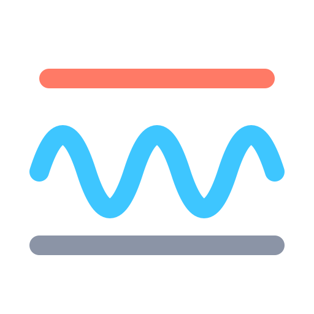

# Headroom

*System-wide parametric EQ at the lowest latency your hardware allows.*

> **AI-generated code disclaimer:** This project was built with Claude 5.5 Sonnet (Anthropic), an AI model. The code has not been independently audited. It may contain bugs and is provided as is, so review it and test it before relying on it. Licensed under the [MIT License](LICENSE).

A Windows application written in Rust that takes system audio through VBMatrix (the "In" WDM endpoints), across the "EQ ASIO Router" virtual ASIO bridge driver that VBMatrix hosts in one of its ASIO slots, runs it through an AutoEQ parametric equalizer and plays it out of a Yamaha/Steinberg USB ASIO device at the lowest latency the hardware allows. It replaces a Voicemeeter / Peace routing chain with one small tray application (plus VBMatrix for routing).

Status: the VBMatrix bridge (virtual ASIO driver v2 plus shared-memory rings) is built, green and running end to end (VBMatrix -> Yamaha) on the author's machine (Steinberg UR22C). The hardware validation checklist (1 h slot stability, flat fill/underrun counters, end-to-end latency recorded in [docs/latency.md](docs/latency.md)) is still open. Pre-bridge latency figures (Hi-Fi Cable / VAC "Line 1" WASAPI sources) are kept in [docs/latency.md](docs/latency.md) marked **Historical (pre-bridge)**; the bridge chain's own end-to-end latency is not yet recorded.

## Features

- AutoEQ `ParametricEQ.txt` import (Preamp, PK / LSC / HSC filters, up to 32 bands), applied live with no click and no audio dropout.
- Live EQ: edit the profile, bypass, limiter, safety buffer and resampler quality while audio plays (config hot reload).
- VBMatrix source: Windows audio lands on the "VBMatrix In" endpoints, VBMatrix patches it into the "EQ ASIO Router" ASIO slot, and the virtual bridge driver hands it to the engine over shared-memory rings (`bridge-abi`) — no WASAPI capture in the engine.
- Post-EQ loopback: the processed stereo mix is fed back to VBMatrix through the bridge's ASIO input side (ring B), so VBMatrix can patch the EQ'd audio onward to recordings or other apps (`[bridge] loopback_enabled`).
- Drift-compensated resampling: a Kaiser-sinc resampler with a PI drift controller keeps the bridge clock and the Yamaha clock locked at any rate pair (44.1 / 48 / 96 kHz ...).
- Latency control: ring target derived from the measured ring-fill statistics ("Learn (30 s)" button), auto safety buffer.
- Safety: soft limiter, automatic headroom (preamp lowered so the profile never boosts above 0 dBFS), fault detector that fade-mutes on non-finite samples, huge peaks, underruns or source gaps.
- Busy-device handling: if another program holds the Yamaha (VBMatrix, VirtualDJ, a DAW ...) the engine shows who, waits and starts by itself when the device is free. Failures restart with exponential back-off.
- Tray application with "run at login" (per-user registry Run value, no service) and single-instance protection.
- Process hardening: EcoQoS opt-out, 1 ms timer resolution, MMCSS "Pro Audio" on the control and ASIO callback threads, a watchdog for stalled threads.
- `router-cli latency`: end-to-end click latency measurement (a quiet click injected into a "VBMatrix In" endpoint, detected at the bridge source tap and on the Yamaha's loopback inputs; its result is stored and used by the latency readout), see [docs/latency.md](docs/latency.md#5a-end-to-end-measurement-router-cli-latency).

## Requirements

- Windows 10/11 x64.
- VBMatrix (VB-Audio Matrix) as the routing matrix, with the "EQ ASIO Router" bridge driver registered in one of its ASIO slots (`scripts\install-driver.ps1`, self-elevating; the 64-bit DLL is registered by default because VBMatrix is x64, `-Both` adds the 32-bit DLL for 32-bit ASIO hosts). It replaces the former Hi-Fi Cable / VAC WASAPI sources.
- A Yamaha/Steinberg USB ASIO interface (default master: `Yamaha Steinberg USB ASIO`). Any ASIO driver that exposes at least two outputs with a supported sample type can be named in `master_driver`, but only the Yamaha is tested.
- Rust stable (MSVC toolchain) to build. No Steinberg ASIO SDK is needed.

## Quick start

1. Install VBMatrix and the Yamaha driver; set Windows default playback to a `VBMatrix In` endpoint ([setup guide](docs/setup-guide.md)).
2. Register the bridge driver (self-elevating):

```powershell
.\scripts\install-driver.ps1          # 64-bit DLL (VBMatrix is x64); -Both adds 32-bit
```

3. In VBMatrix, pick **"EQ ASIO Router"** in an ASIO slot and patch your `VBMatrix In` strips to it. Keep VBMatrix's master clock on **Internal Clock** and never select "EQ ASIO Router" as a Device Master: the bridge DLL is self-clocked (its own pacing thread) and the router engine refuses to use it as its own master — the Yamaha stays the master.
4. Close anything else using the Yamaha (`router-cli holders` shows who).
5. Build and start the tray app:

```powershell
cargo build --release -p eq-asio-app -p router-cli
.\target\release\eq-asio-app.exe
```

6. In the window, press Start, then load an AutoEQ `ParametricEQ.txt`. Tick "Run at login" if wanted.
7. Headless alternative: `.\target\release\router-cli.exe run` (Ctrl+C to stop).

## Architecture

```
 apps -> Windows mixer -> VBMatrix In (WDM) -> VBMatrix matrix
                                                     |
                       ASIO slot "EQ ASIO Router" (eq_asio_driver.dll, hosted by VBMatrix;
                       8 in / 8 out, self-clocked pacing thread)        bridge-abi
                                                     |
                     shm ring A (source) / shm ring B (post-EQ loopback)
                                                     |
        engine process, Yamaha ASIO callback thread (router-engine::pipeline):
          RateMatcher (startup gate, PI drift controller, Kaiser-sinc resampler)
            -> EqProcessor (preamp, biquads, soft limiter, fault detector)
            -> asio_convert (f32 -> Int32LSB etc.)
            -> Yamaha ASIO output buffers -> USB -> DAC
        loopback feeder thread: EQ tap -> resampler -> ring B -> VBMatrix

 control thread (STA): engine state machine, retry/back-off, config watcher,
 bridge status tick, watchdog, logger, status block (Local\eq_asio_router_status) <- GUI / tray
```

Details: [docs/architecture.md](docs/architecture.md).

## Documentation

| Document | Content |
|---|---|
| [docs/README.md](docs/README.md) | Index of all documents, including the reverse-engineering and latency reports |
| [docs/setup-guide.md](docs/setup-guide.md) | Windows, Yamaha and cable setup |
| [docs/configuration.md](docs/configuration.md) | `config.toml`, `app_settings.toml`, status block, CLI reference |
| [docs/latency.md](docs/latency.md) | Latency budget, measurements, how to reduce it |
| [docs/troubleshooting.md](docs/troubleshooting.md) | Symptom, cause, fix |
| [docs/development.md](docs/development.md) | Build, test, conventions, licensing |

## Crates

`eq-core` (DSP, config, AutoEQ, status layout), `router-core` (ring, resampler, drift control, processor, logger, watchdog), `bridge-abi` (shared-memory bridge contract between the driver and the app: mapping layout, ring helpers), `router-engine` (engine, pipeline, bridge source and loopback feeder, priority), `wasapi-capture` (capture-probe measurement tool only), `asio-abi` / `asio-host` (ASIO hosting), `router-cli`, `eq-asio-app` (egui GUI and tray), `asio-probe`, and `eq-asio-driver` (the v2 virtual ASIO bridge driver "EQ ASIO Router" that VBMatrix hosts in an ASIO slot; same registered name and CLSID as the old v1 driver).

## License

The repository is MIT licensed (workspace `Cargo.toml`). The Steinberg ASIO SDK is not included and not required. See [docs/development.md](docs/development.md) for third-party notes.
